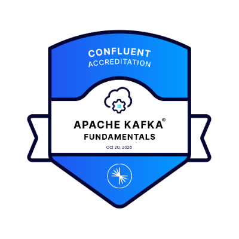
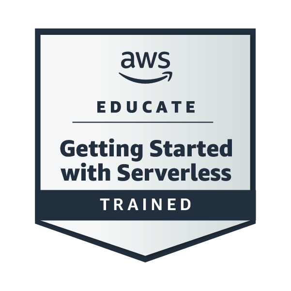
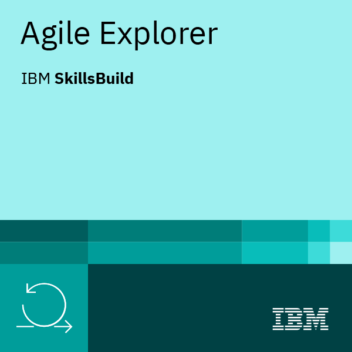
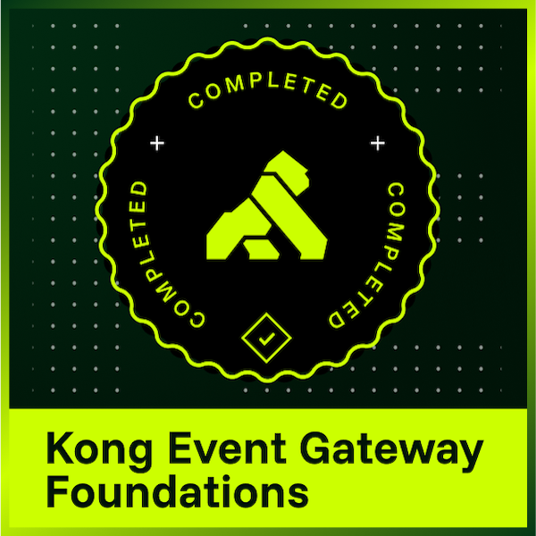

### Hi there, I'm Hikmet 👋

I’m a software engineer focusing on backend systems, software architecture, and scalable applications. Here you’ll find my projects and experiments around distributed systems, API design, database optimization, and real-world problems experienced in production environments.

I enjoy designing scalable systems, making architectural decisions, and turning complex problems into clean, maintainable solutions.

- 🔭 **Currently focusing on:** distributed systems, event-driven architecture and cloud-native development on AWS
- 📚 **Fun fact:** I love reading books

### 🛠 Tech Stack

**Backend**

  

**Frontend**

  

**Data & Messaging**

  

**Cloud & DevOps**

  

## 🏅 Certifications & Credentials

<table>
  <tr>
    <td align="center" valign="middle">
      
    </td>
    <td align="center" valign="middle">
      
    </td>
    <td align="center" valign="middle">
      
    </td>
    <td align="center" valign="middle">
      
    </td>
    <td align="center" valign="middle">
      
    </td>
  </tr>
</table>

### 🔗 Connect

 

<picture>
  <source media="(prefers-color-scheme: dark)" srcset="https://raw.githubusercontent.com/hikmetkutuk/hikmetkutuk/output/github-contribution-grid-snake-dark.svg">
  <source media="(prefers-color-scheme: light)" srcset="https://raw.githubusercontent.com/hikmetkutuk/hikmetkutuk/output/github-contribution-grid-snake.svg">
  
</picture>
